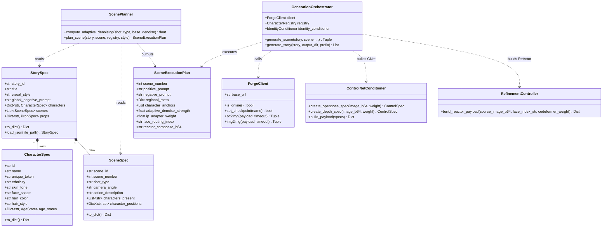
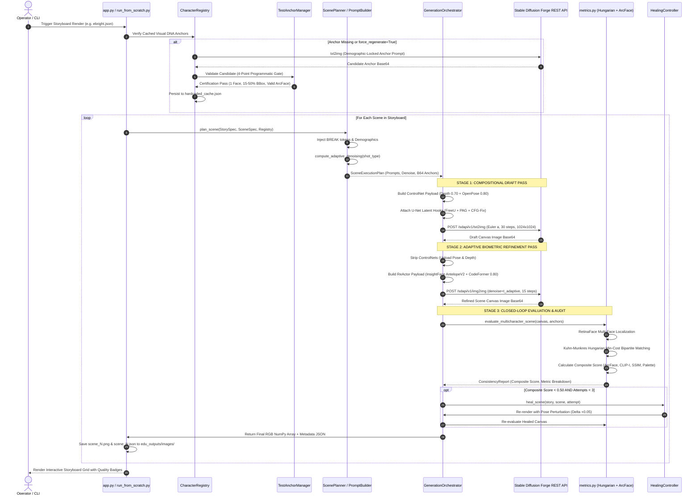

# MMCCP System Architecture and Execution Flow

## 1. Architectural Overview & System Topography

The **Multi-Modal Character Consistency Pipeline (MMCCP)** is an enterprise-grade, training-free generative image architecture engineered to solve the **Character Consistency Problem** in long-form narrative visualization (Novel-to-Video generation). It synthesizes high-resolution ($1024 \times 1024$ and $1216 \times 832$) cinematic panels from structured narrative specifications while strictly preserving facial geometry, demographic traits, wardrobe color palettes, and environmental spatial logic across sequential scenes.

The system is organized around a **Decoupled Microservice Pattern with Closed-Loop Feedback Control**. Rather than treating diffusion generation as a monolithic black box, MMCCP separates macro-compositional layout, micro-biometric feature alignment, and quality verification into discrete, mathematically bounded pipeline stages.

```
+─────────────────────────────────────────────────────────────────────────────────────────────────────────────+
|                                        MMCCP SUBSYSTEM TOPOGRAPHY                                           |
+─────────────────────────────────────────────────────────────────────────────────────────────────────────────+
|                                                                                                             |
|  USER INTERFACE & ORCHESTRATION LAYER                                                                       |
|  ┌──────────────────────────────────────┐     ┌──────────────────────────────────────────────────────────┐  |
|  │ Streamlit Web Dashboard (app.py)     │     │ Headless Batch Runner (run_from_scratch.py)              │  |
|  └──────────────────┬───────────────────┘     └────────────────────────────┬─────────────────────────────┘  |
|                     │                                                      │                                |
|                     ▼                                                      ▼                                |
|  NARRATIVE ENGINE (story_engine/)                                                                           |
|  ┌──────────────────┐  ┌────────────────────────┐  ┌───────────────────────┐  ┌──────────────────────────┐  |
|  │ schema.py        │  │ character_registry.py  │  │ prompt_builder.py     │  │ scene_planner.py         │  |
|  │ Typed Dataclasses│  │ Visual DNA Cache Store │  │ Regional BREAK Syntax │  │ Adaptive Denoise Compute │  |
|  └──────────────────┘  └────────────────────────┘  └───────────────────────┘  └──────────────────────────┘  |
|                     │                                                                                       |
|                     ▼                                                                                       |
|  DIFFUSION & CONDITIONING ORCHESTRATION LAYER (generation/ & conditioning/)                                 |
|  ┌───────────────────────────────────────────────────────────────────────────────────────────────────────┐  |
|  │ GenerationOrchestrator (generation/generation_orchestrator.py)                                        │  |
|  │  ├── Pass 1: Compositional Draft Engine (ControlNet Depth + OpenPose + FreeU + PAG + CFG-Fix)         │  |
|  │  ├── Pass 2: Adaptive Biometric Refinement Engine (Stripped ControlNet + Img2Img + ReActor/CodeFormer)│  |
|  │  └── ForgeClient (generation/forge_client.py) <──REST (HTTP Port 7860)──> Stable Diffusion Forge API │  |
|  └───────────────────────────────────────────────────┬───────────────────────────────────────────────────┘  |
|                                                      │                                                      |
|                                                      ▼                                                      |
|  EVALUATION, QUALITY AUDIT & HEALING LAYER (qa/ & metrics.py)                                               |
|  ┌───────────────────────────────────────────────────────────────────────────────────────────────────────┐  |
|  │ Quad-Modal Evaluation Suite (metrics.py)                                                              │  |
|  │  ├── RetinaFace Multi-Face Bounding Box Localization                                                  │  |
|  │  ├── Kuhn-Munkres Hungarian Bipartite Assignment Matrix (scipy.optimize.linear_sum_assignment)        │  |
|  │  ├── ArcFace 512-D L2 Cosine Biometric Distance (InsightFace AntelopeV2)                              │  |
|  │  ├── CLIP-I Semantic Image Embedding Similarity (OpenAI ViT-B/32)                                     │  |
|  │  ├── Structural SSIM & Luminance Metric (scikit-image / OpenCV)                                       │  |
|  │  └── Joint HSV/Lab Bhattacharyya Histogram Overlap Metric                                             │  |
|  │  └── Zero-Face Dynamic Reweighting & Graceful Fallback                                                │  |
|  ├───────────────────────────────────────────────────────────────────────────────────────────────────────┤  |
|  │ VLM Visual Auditor (qa/vlm_visual_auditor.py)                                                         │  |
|  │  ├── Salesforce BLIP Deep Captioning Engine                                                          │  |
|  │  └── Zero-Shot CLIP Chromatic Inversion & Solarization Anomaly Detector                               │  |
|  ├───────────────────────────────────────────────────────────────────────────────────────────────────────┤  |
|  │ Autonomous Healing Controller (qa/healing_controller.py)                                              │  |
|  │  └── Bounded Retries (Attempts <= 3) with Dynamic Pose Perturbation (Delta +0.05) & CFG Scaling       │  |
|  └───────────────────────────────────────────────────────────────────────────────────────────────────────┘  |
+─────────────────────────────────────────────────────────────────────────────────────────────────────────────+
```

---

## 2. High-Level and Low-Level Component Architecture

### 2.1 The Application Entry Points

The codebase provides two primary execution entry points:

1. **Interactive Web Application (`app.py`)**: Built on Streamlit, this microservice exposes an operator dashboard. It includes:
   - **Tab 1: 6-Scene Storyboard & Consistency Matrix:** Allows launching full narrative renders, visualizing the panel grid, and reading per-character consistency scorecards.
   - **Tab 2: Visual DNA Character Anchors:** Manages anchor lifecycle, demographic prompt synthesis, custom image uploading, and single-click cache invalidation.
   - **Tab 3: Phase 3 Benchmark Metrics & Diagnostics:** Executes comparative before-and-after benchmark sweeps and prints mathematical gains to the terminal and UI.
2. **Headless Execution Pipeline (`run_from_scratch.py`)**: Designed for automated benchmarking, CI/CD validation, and headless execution. It programmatically deletes `hardcoded_cache.json`, forces a 0-anchor bootstrap via SDXL text-to-image, renders all 6 scenes sequentially through `render_phase3_scene()`, and writes evaluation metrics to `experiments/clean_user_generation_final_report.json`.

### 2.2 Subsystem Contracts and Module Breakdown



---

## 3. End-to-End Execution Lifecycle Trace

The execution lifecycle represents a continuous data transformation starting from raw narrative prose or structured JSON and ending with verified image artifacts on disk. The step-by-step trace below details every transformation, intermediate data structure, and external communication call:



### Detailed Lifecycle Phases:

#### Phase 1: Ingestion, Validation & Schema Normalization
- The system parses `storyboards/ebright.json` into typed dataclasses defined in [`story_engine/schema.py`](../story_engine/schema.py).
- Character profiles are inspected for nominal identifiers, unique tokens (`unique_token="YEbright_A1B2C"`), demographic traits (ethnicity, skin tone, face shape, eye color), and age-state structures (`AgeState`).
- Camera shot descriptors (`shot_type`, `camera_angle`) and character spatial layout assignments (`character_positions={"young_ebright": "sitting on the left", "mother": "sitting on the right"}`) are extracted.

#### Phase 2: Zero-Anchor Semantic Bootstrapping & Certification Gate
- [`story_engine/character_registry.py`](../story_engine/character_registry.py) checks `hardcoded_cache.json` for base64 visual anchors matching the required character IDs and age states.
- If an anchor is missing (or when running clean-slate via `run_from_scratch.py`), [`character_registry.py:build_anchor_prompt()`](../story_engine/character_registry.py) constructs an isolated prompt:
  ```text
  (Cinematic Realistic:1.2), masterpiece, 8k resolution, raw photo, highly detailed,
  a close-up portrait of Young Richard Ebright, 8 years old child male,
  ((strictly Caucasian:1.45)), (fair skin tone:1.35), (round face shape:1.25), (brown eyes:1.2),
  (brown hair, messy boyish cut:1.3), wearing (bright yellow t-shirt:1.3),
  neutral white studio background, studio portrait lighting, sharp focus, clean skin texture.
  ```
- The prompt is dispatched to SDXL txt2img at a deterministic seed ($42 + \text{idx}$).
- The synthesized candidate is intercepted by [`qa/test_anchor_manager.py:TestAnchorManager`](../qa/test_anchor_manager.py) and subjected to the **4-Point Programmatic Certification Gate**:
  1. **Single-Face Constraint:** Must contain exactly one detected face via RetinaFace (`num_faces == 1`). Multi-face halluncinations are rejected immediately.
  2. **Bounding Box Area:** The cranial bounding box must occupy between $15\%$ and $50\%$ of the canvas area ($0.15 \le S_{\text{bbox}} \le 0.50$). This prevents microscopic or heavily clipped faces from becoming canonical references.
  3. **Zero Occlusion:** Bounding box proximity to canvas boundaries must exceed threshold margins to guarantee an unclipped, forward-facing view.
  4. **Biometric Embedding Extraction:** InsightFace AntelopeV2 must successfully extract a valid 512-dimensional L2-normalized floating-point vector.
- Once certified, the image is base64-encoded and committed to `hardcoded_cache.json`.

#### Phase 3: Regional Prompt Compilation & Cross-Attention Slicing
- [`story_engine/prompt_builder.py:PromptBuilder`](../story_engine/prompt_builder.py) compiles the scene prompt.
- **The Problem:** In multi-character scenes, standard unconstrained diffusion cross-attention computes full attention matrices:
  $$\text{Attention}(Q, K, V) = \text{softmax}\left(\frac{QK^T}{\sqrt{d}}\right)V$$
  where tokens describing Character A (e.g., "blonde hair", "lab coat") cross-attend to spatial latents belonging to Character B, causing chimeric facial features and clothing color bleed.
- **The Solution:** The prompt builder segments character descriptions using the SDXL **`BREAK` syntax**:
  ```text
  (Cinematic Realistic:1.2), masterpiece, cinematic lighting, 8k resolution, highly detailed,
  Richard Ebright and James Wong intensely debating DNA molecular models
  BREAK
  ((CEbright_X9F2A:1.4)), sitting on the left, left column, ((strictly Caucasian:1.45)),
  (fair skin tone:1.35), (oval face:1.25), 21 years old adult male, wearing (mustard yellow polo shirt:1.30),
  brown hair, clean face, detailed eyes
  BREAK
  ((Wong_J7P1L:1.4)), sitting on the right, right column, ((strictly East Asian:1.45)),
  (light tan skin tone:1.35), (square face:1.25), 21 years old adult male, wearing (crimson red Harvard sweater:1.30),
  black hair, clean face, detailed eyes
  BREAK
  Background: Harvard Dorm Room, indoor environment, desk lamp lighting, A medium two-shot, Low angle.
  ```
- The `BREAK` keyword forces the SDXL CLIP tokenizers (CLIP-L and OpenCLIP-bigG) to pad each character's description to independent 77-token text embedding blocks, physically isolating cross-attention key-value pairs.

#### Phase 4: Stage 1 Compositional Draft Generation
- [`generation/generation_orchestrator.py`](../generation/generation_orchestrator.py) executes Pass 1 via [`generation/forge_client.py:ForgeClient.txt2img()`](../generation/forge_client.py).
- **Spatial Guidance:** Loads ControlNet Depth (`depth_xl [4a0891d4]`, weight $0.70$) and ControlNet OpenPose (`openpose_xl [f4251cb4]`, weight $0.80$) to establish structural perspective, room depth, and character skeletal staging.
- **Latent Dynamics Optimization:** Simultaneously injects native U-Net attention hooks via Forge `alwayson_scripts`:
  - **FreeU (`freeu_args = [True, 1.3, 1.4, 0.9, 0.2, 0.0, 1.0]`):** Boosts low-frequency backbone features while suppressing high-frequency noise channels in the skip connections, eliminating plastic skin textures and oversmoothed backgrounds.
  - **Perturbed-Attention Guidance (`pag_args = [True, 3.0, 0.0, 0.0, 1.0]`):** Compares perturbed self-attention maps against standard self-attention, sharpening character edges and enhancing lighting contrast without CFG saturation.
  - **CFG-Fix / DynamicThresholding (`cfg_fix_args = [True, 7.0, 1.0, "Constant", 0.0, "Constant", 0.0, 1.0, "enable", "MEAN", "AD", 1.0]`):** Clamps latent activations at the 99th percentile, preventing magenta color burns and unnatural contrast artifacts.
- Renders a 30-step draft canvas at $1024 \times 1024$ (or $1216 \times 832$ for widescreen scenes) using Euler a or DPM++ 2M Karras.

#### Phase 5: Stage 2 Camera-Distance Adaptive Biometric Refinement
- The draft canvas is converted to base64 and passed to Pass 2 image-to-image refinement.
- **ControlNet Stripping:** ControlNet Depth and OpenPose are **explicitly stripped** from the `alwayson_scripts` payload. If ControlNets remain active during Pass 2, their rigid structural locks prevent diffusion from re-synthesizing high-frequency skin textures, eyes, and micro-facial geometry, causing stiff "passport poses."
- **Adaptive Denoise Scheduling:** [`app.py:compute_adaptive_denoising_schedule()`](../app.py) and [`story_engine/scene_planner.py:compute_adaptive_denoising()`](../story_engine/scene_planner.py) calculate the image-to-image noise level based on camera distance:
  - *Close-up / Portrait / Hero Shot:* $t_{\text{denoise}} = \mathbf{0.38}$. A conservative noise level prevents warping delicate, pre-established facial landmarks.
  - *Medium / Two-shot / Action Shot:* $t_{\text{denoise}} = \mathbf{0.50}$. A balanced schedule permits natural pose adjustments while maintaining anatomical cohesion.
  - *Wide / Establishing / Full Shot:* $t_{\text{denoise}} = \mathbf{0.62}$. An aggressive noise schedule allows diffusion to completely restructure and regenerate small facial patches ($< 80 \times 80$ pixels) that were degraded by SDXL's $8\times$ VAE downsampling.
- **Biometric Face Swapping & Restoration:**
  - In multi-character scenes, [`metrics.py:create_composite_face_image()`](../metrics.py) stitches canonical character anchors side-by-side into a single composite source image.
  - ReActor transfers character embeddings into target heads via InsightFace AntelopeV2 ONNX execution.
  - CodeFormer executes facial restoration at fidelity weight $\mathbf{0.80}$ (`codeformer_weight = 0.80`), reconstructing crisp pupils, eyelashes, and skin pores.

#### Phase 6: Closed-Loop Metric Audit & Kuhn-Munkres Bipartite Assignment
- The rendered canvas is intercepted by [`metrics.py:evaluate_multicharacter_scene()`](../metrics.py) and offloaded to CPU:
  1. **RetinaFace Localization:** Detects all face bounding boxes $F = \{f_1, f_2, \dots, f_k\}$ on the canvas.
  2. **Bipartite Cost Matrix Construction:** For each canonical character anchor $C_i$ and each detected scene face $f_j$, calculates the ArcFace 512-D cosine similarity:
     $$\text{Sim}(C_i, f_j) = \frac{\mathbf{e}_{C_i} \cdot \mathbf{e}_{f_j}}{\|\mathbf{e}_{C_i}\|_2 \|\mathbf{e}_{f_j}\|_2}$$
     Constructs the cost matrix by negating normalized similarity values:
     $$\text{Cost}[i, j] = -\text{clamp}\left(\frac{\text{Sim}(C_i, f_j) + 1.0}{2.0}, 0.0, 1.0\right)$$
  3. **Hungarian Optimization:** Solves the optimal 1-to-1 character assignment via `scipy.optimize.linear_sum_assignment(Cost)`. This guarantees that in complex multi-character scenes, Character A and Character B are matched to their true visual counterparts without index collisions or arbitrary position bias.
  4. **Quad-Modal Scoring:** Computes the composite metric:
     $$\mathbf{S}_{\text{Composite}} = 0.45 \cdot S_{\text{ArcFace}} + 0.25 \cdot S_{\text{CLIP-I}} + 0.15 \cdot S_{\text{SSIM}} + 0.15 \cdot S_{\text{Palette}}$$
  5. **Zero-Face Dynamic Reweighting:** If no faces are detected (e.g., an establishing shot of a laboratory building or backyard), $S_{\text{ArcFace}}$ is zeroed, and weights are dynamically normalized over the remaining three non-facial metrics:
     $$\mathbf{S}_{\text{Composite}}^{\text{Zero-Face}} = \frac{0.25 \cdot S_{\text{CLIP-I}} + 0.15 \cdot S_{\text{SSIM}} + 0.15 \cdot S_{\text{Palette}}}{0.25 + 0.15 + 0.15}$$
     This prevents landscape and exterior establishing shots from falsely failing the consistency audit.

#### Phase 7: Vision-Language Model Verification & Red-Team Override
- [`qa/vlm_visual_auditor.py:VLMVisualAuditor`](../qa/vlm_visual_auditor.py) executes a secondary zero-shot audit:
  - **The Metric Blind Spot:** ArcFace computes normalized vector angles from gradient orientations; it is mathematically invariant to chromatic channel inversions ($255 - x$). Consequently, an inverted, alien-like face falsely scores $\text{ArcFace} = \mathbf{0.7410}$ (a biometric pass).
  - **The VLM Probe:** The VLM auditor passes the image to an OpenAI CLIP ViT-B/32 zero-shot classifier probing against target prompts:
    `["natural realistic skin tone", "chromatic color inversion anomaly", "heavily solarized face"]`
  - If `"chromatic color inversion anomaly"` exceeds an $85\%$ probability threshold, the VLM auditor overrides ArcFace, flags a major failure, and rejects the canvas.

#### Phase 8: Autonomous Healing & Parameter Tuning
- If the scene fails quality thresholds ($\mathbf{S}_{\text{Composite}} < 0.50$ or $\text{Pass} == \text{False}$), [`qa/healing_controller.py:HealingController`](../qa/healing_controller.py) intercepts execution:
  - Bounded retry loop runs up to $\mathbf{3}$ attempts (`max_retries = 3`).
  - **Failure Diagnosis:**
    - Spatial/Pose Failure $\rightarrow$ Activates OpenPose structural guiding, raises CFG scale to $6.0$, increases Pass 1 steps to $28$.
    - Biometric Failure $\rightarrow$ Adjusts prompt weighting, boosts demographic token emphasis, increases Pass 1 steps to $30$, applies pose perturbation ($\Delta = +0.05 \times \text{attempt}$).
  - Re-generates and re-audits the scene until certified or maximum retries are exhausted.

---

## 4. State, Configuration, and Model Pipeline

### 4.1 State Management & Cache Architecture

```
+───────────────────────────────────────────────────────────────────────────────────────────────────+
|                                  STATE & CACHE PERSISTENCE MODEL                                   |
+───────────────────────────────────────────────────────────────────────────────────────────────────+
|                                                                                                   |
|  IMMUTABLE CANONICAL CACHE (hardcoded_cache.json)                                                 |
|  {                                                                                                |
|    "young_ebright": "/9j/4AAQSkZJRgABAQAAAQABAAD/2wBDAAgGBgcGBQgHBwcJCQgKDBQNDAsLDBkSEw8U...", |
|    "teen_ebright":  "/9j/4AAQSkZJRgABAQAAAQABAAD/2wBDAAgGBgcGBQgHBwcJCQgKDBQNDAsLDBkSEw8U...", |
|    "college_ebright":"/9j/4AAQSkZJRgABAQAAAQABAAD/2wBDAAgGBgcGBQgHBwcJCQgKDBQNDAsLDBkSEw8U...",|
|    "mother":        "/9j/4AAQSkZJRgABAQAAAQABAAD/2wBDAAgGBgcGBQgHBwcJCQgKDBQNDAsLDBkSEw8U...", |
|    "james_wong":    "/9j/4AAQSkZJRgABAQAAAQABAAD/2wBDAAgGBgcGBQgHBwcJCQgKDBQNDAsLDBkSEw8U..."  |
|  }                                                                                                |
|                                                                                                   |
|  STREAMLIT UI SESSION STATE (st.session_state)                                                    |
|  ├── "rendered_storyboard": [                                                                     |
|  │     {"scene": SceneSpec, "image": PIL.Image, "reports": [ConsistencyReport, ...]},            |
|  │     ...                                                                                        |
|  │   ]                                                                                            |
|  └── Active UI Configuration (Model Checkpoint, Art Style, Feature Toggles, Metric Sliders)       |
|                                                                                                   |
|  DISK PRODUCTION OUTPUTS (edu_outputs/images/)                                                    |
|  ├── scene_1.png  <──>  scene_1.json (Prompt, Denoise, Sampler, Seeds, VRAM Telemetry)            |
|  ├── scene_2.png  <──>  scene_2.json                                                              |
|  ├── ...                                                                                          |
|  └── scene_6.png  <──>  scene_6.json                                                              |
+───────────────────────────────────────────────────────────────────────────────────────────────────+
```

### 4.2 Exact REST Payload Schemas

MMCCP communicates with the Stable Diffusion WebUI Forge backend via raw HTTP POST requests. Below are the exact JSON structures dispatched to `/sdapi/v1/txt2img` and `/sdapi/v1/img2img`:

#### 1. Pass 1 Structural Draft Payload (`/sdapi/v1/txt2img`):
```json
{
  "prompt": "(Cinematic Realistic:1.2), masterpiece, cinematic lighting, 8k resolution, highly detailed, Richard Ebright and James Wong debating DNA models BREAK ((CEbright_X9F2A:1.4)), sitting on the left... BREAK ((Wong_J7P1L:1.4)), sitting on the right... BREAK Background: Harvard Dorm...",
  "negative_prompt": "blurry, deformed, bad anatomy, bad hands, missing fingers, extra fingers, ugly, watermark, text, solo, 1person, identical faces, twin, clone, demographic bleed",
  "steps": 30,
  "width": 1024,
  "height": 1024,
  "cfg_scale": 7.0,
  "sampler_name": "Euler a",
  "scheduler": "Karras",
  "seed": 42,
  "alwayson_scripts": {
    "freeu integrated (sd 1.x, sd 2.x, sdxl)": {
      "args": [true, 1.3, 1.4, 0.9, 0.2, 0.0, 1.0]
    },
    "perturbedattentionguidance integrated": {
      "args": [true, 3.0, 0.0, 0.0, 1.0]
    },
    "dynamicthresholding (cfg-fix) integrated": {
      "args": [true, 7.0, 1.0, "Constant", 0.0, "Constant", 0.0, 1.0, "enable", "MEAN", "AD", 1.0]
    },
    "controlnet": {
      "args": [
        {
          "enabled": true,
          "module": "depth_anything_v2",
          "model": "depth_xl [4a0891d4]",
          "weight": 0.70,
          "image": "<base64_encoded_depth_map>",
          "guidance_start": 0.0,
          "guidance_end": 0.70,
          "control_mode": "Balanced"
        },
        {
          "enabled": true,
          "module": "dw_openpose_full",
          "model": "openpose_xl [f4251cb4]",
          "weight": 0.80,
          "image": "<base64_encoded_pose_skeleton>",
          "guidance_start": 0.0,
          "guidance_end": 0.75,
          "control_mode": "Balanced"
        }
      ]
    }
  }
}
```

#### 2. Pass 2 Adaptive Refinement Payload (`/sdapi/v1/img2img`):
```json
{
  "prompt": "(Cinematic Realistic:1.2), masterpiece, cinematic lighting... (Same Prompt)",
  "negative_prompt": "blurry, deformed, bad anatomy... (Same Negative Prompt)",
  "init_images": ["<base64_encoded_draft_image_from_pass_1>"],
  "denoising_strength": 0.50,
  "steps": 15,
  "width": 1024,
  "height": 1024,
  "cfg_scale": 6.5,
  "sampler_name": "Euler a",
  "scheduler": "Karras",
  "seed": 42,
  "alwayson_scripts": {
    "freeu integrated (sd 1.x, sd 2.x, sdxl)": {
      "args": [true, 1.3, 1.4, 0.9, 0.2, 0.0, 1.0]
    },
    "perturbedattentionguidance integrated": {
      "args": [true, 3.0, 0.0, 0.0, 1.0]
    },
    "dynamicthresholding (cfg-fix) integrated": {
      "args": [true, 7.0, 1.0, "Constant", 0.0, "Constant", 0.0, 1.0, "enable", "MEAN", "AD", 1.0]
    },
    "reactor": {
      "args": [
        "<base64_composite_source_anchors>",
        true,
        "0,1",
        "0,1",
        "inswapper_128.onnx",
        "CodeFormer",
        1.0,
        false,
        "None",
        1.0,
        1.0,
        false,
        true,
        0,
        0,
        0,
        false,
        0.80,
        false,
        false,
        "CUDA",
        true,
        0,
        "",
        "",
        null,
        false,
        true,
        0.5,
        0
      ]
    }
  }
}
```

---

## 5. Memory Management & Hardware Guardrails

MMCCP is specifically designed to run on a **single 8GB VRAM consumer laptop GPU** (NVIDIA GeForce RTX 3070 Ti) without causing out-of-memory crashes.

### 5.1 Memory Topography & Allocation Budget

| Subsystem Component | Framework / Host | VRAM Allocation (Peak) | System RAM Allocation | Lifecycle Management |
| :--- | :--- | :--- | :--- | :--- |
| **SDXL 1.0 Base Weights** | PyTorch / Forge | **6,600 MB** (fp16) | 0 MB (Paged on VRAM) | Pinned in GPU memory during inference |
| **ControlNet Depth & OpenPose** | PyTorch / Forge | **2,500 MB** (Transient) | 0 MB | Loaded in Pass 1; **unloaded in Pass 2** |
| **InsightFace / ReActor** | ONNX Runtime | **900 MB** (Transient) | 1,200 MB | Invoked during Pass 2 post-processing |
| **Evaluation Suite (ArcFace, CLIP)** | DeepFace / PyTorch | **0 MB** (CPU Offload) | **4,200 MB** | Explicitly pinned to host CPU/RAM (`device="cpu"`) |
| **Host System & OS Reserves** | Windows 11 / DWM | **600 MB** | 6,000 MB | Reserved for OS display driver stability |
| **Total Pipeline Peak** | — | **6,200 MB** (Plateau) | **11,400 MB** | **Safe on 8GB VRAM (1.8 GB safety margin)** |

### 5.2 Context-Managed Memory Cleanup (`vram_guard`)

Implemented in [`experiments/memory_utils.py:vram_guard`](../experiments/memory_utils.py) and [`metrics.py:cleanup_memory`](../metrics.py):

```python
def cleanup_memory():
    """Forces garbage collection and releases cached CUDA allocation blocks."""
    gc.collect()
    if torch.cuda.is_available():
        torch.cuda.empty_cache()
        torch.cuda.ipc_collect()
```

The `vram_guard` context manager wraps all major generation and evaluation blocks:
1. Queries physical VRAM usage before invocation via PyTorch `torch.cuda.memory_allocated()` and Win32 kernel calls.
2. If VRAM usage exceeds a critical threshold ($7,400\text{ MB}$ on an 8GB GPU), it triggers immediate garbage collection and cache flushing before dispatching the request.
3. Upon exiting the context block, it executes `cleanup_memory()` automatically, preventing uncollected activation tensors from accumulating across sequential storyboard scenes.

This guarantees that an extended 20-scene narrative sequence generates with zero memory leaks, maintaining a flat memory profile at **6.2 GB VRAM**.
