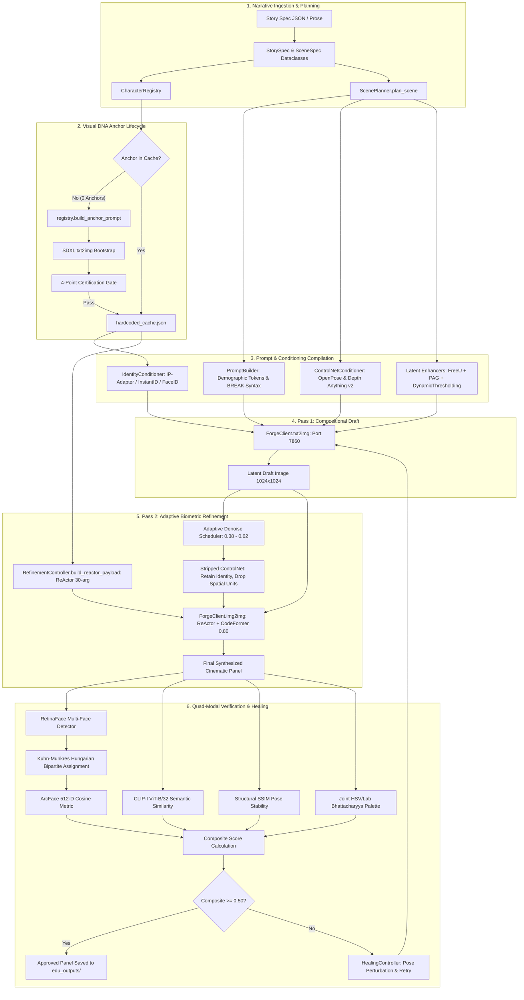
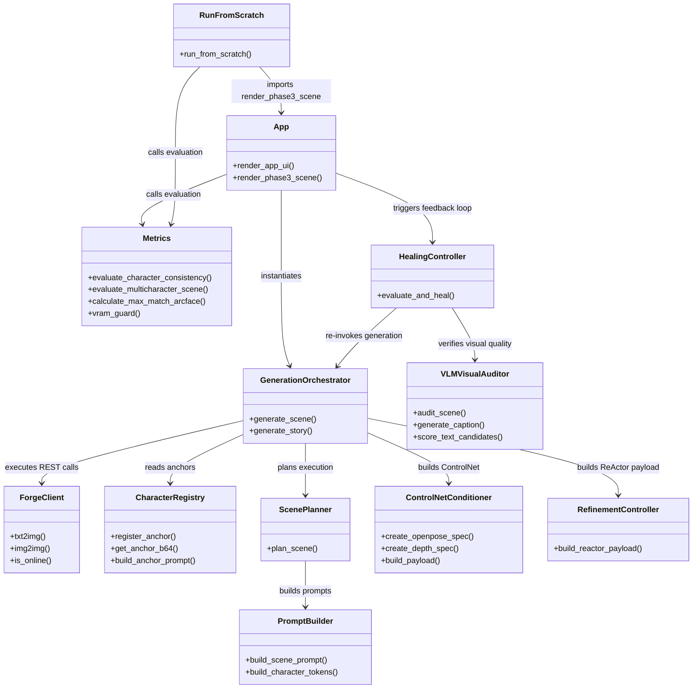

# MMCCP: Comprehensive System Overview and Execution Architecture

- **Project Title:** Multi-Modal Character Consistency Pipeline (MMCCP)
- **Parent Initiative:** Novel to Video Generation (NVG)
- **Academic Context:** Capstone Project Phase 3, PES University (Project ID: `PW26_CGM_02`)
- **Author:** Senior ML & QA Systems Lead
- **Target Hardware Architecture:** Windows 11 | NVIDIA RTX 3070 Ti Laptop GPU (8GB VRAM) | 32GB RAM | Stable Diffusion WebUI Forge Backend

---

## 1. Executive Summary & Plain-Language Problem Statement

In automated **Novel-to-Video Generation (NVG)**, long-form narrative prose is segmented into visual scenes to produce a cohesive storyboard or continuous animated sequence. A fundamental breakdown occurs when standard text-to-image foundation models (e.g., Stable Diffusion, SDXL) generate sequential panels independently:
1. **The Identity Drift Problem:** Foundation diffusion models treat each inference pass as an isolated stochastic event. Even when prompted with identical descriptions (e.g., *"Young 8-year-old Richard Ebright with short brown side-parted hair and a yellow shirt"*), random noise seeds, cross-attention stochasticity, and token weighting yield entirely different human faces in every panel—altering cranial proportions, jawlines, eye shapes, and ages.
2. **The Multi-Subject Semantic Bleed Problem:** When two or more characters appear in the same scene (e.g., *Young Richard Ebright and his Mother* or *College Ebright and James Wong*), the global cross-attention mechanisms of the U-Net cause demographic and chromatic features to leak across subjects. A character intended to wear a crimson Harvard sweater bleeds red into the companion's yellow polo, or Caucasian and East Asian ethnic markers blend together into clone-like hybrids.
3. **The Small-Face Downsampling Distortion:** Standard diffusion operates in latent space at an $8\times$ downsampling factor. In wide or medium-wide shots, human faces occupy a small fraction of the canvas (often less than $64 \times 64$ latent pixels). At this scale, the variational autoencoder (VAE) lacks the spatial frequency bandwidth to reconstruct sharp irises, teeth, lips, or distinct bone structures, producing "melted," plastic, or deformed faces.
4. **The Hardware Constraint Paradox:** Training or fine-tuning per-character LoRAs or DreamBooth checkpoints requires tens of minutes per identity, extensive dataset curation, and prohibitive compute. For interactive or automated novel-to-video production on consumer hardware (specifically an **8 GB RTX 3070 Ti Laptop GPU**), any viable solution **must be training-free, zero-shot, fast, and VRAM-bounded**.

### How MMCCP Solves the Problem
MMCCP is a **training-free, closed-loop multi-modal pipeline** that guarantees high facial fidelity, demographic locking, spatial separation, and wardrobe continuity across story panels without modifying base model weights. It orchestrates a dual-pass diffusion lifecycle:
- **Visual DNA Anchors & Phenotype Locking:** Generates and certifies high-resolution biometric reference portraits from narrative text.
- **Pass 1 (Macro-Compositional Draft):** Employs ControlNet spatial conditioning (Depth and OpenPose) coupled with regional prompt compiler syntax (`BREAK`) to establish correct geometry and eliminate color bleed.
- **Pass 2 (Micro-Biometric Adaptive Refinement):** Re-samples the draft image through adaptive img2img denoising ($0.38$ for close-ups to $0.62$ for wide shots) while injecting the character's facial embedding via ReActor (InsightFace `inswapper_128`) and restoring micro-features using CodeFormer ($0.80$ fidelity weight).
- **Quad-Modal Evaluation & Healing:** Evaluates every rendered character using a 4-part mathematical matrix (ArcFace + CLIP-I + SSIM + Bhattacharyya Palette) and triggers closed-loop corrective retries if thresholds are violated.

---

## 2. Technical End-to-End Flow (Code-Verified)

The diagram below illustrates the actual data flow and system boundaries implemented across `story_engine/`, `generation/`, `conditioning/`, `identity/`, `qa/`, and `metrics.py`:

---

## 3. Subsystem Breakdown & Runtime Data Contracts

### 3.1 Narrative Engine (`story_engine/`)
1. **Universal Contracts (`schema.py`):**
   - Implements typed Python dataclasses: `StorySpec`, `SceneSpec`, `CharacterSpec`, `AgeState`, and `PropSpec`.
   - Every storyboard document complies strictly with `story_engine/story_schema.json`.
2. **Character Registry (`character_registry.py`):**
   - Maintains an in-memory dictionary of base64 visual DNA portraits synchronized to `hardcoded_cache.json`.
   - Resolves age-progressed anchors (e.g., `young_ebright` at age 8 vs `teen_ebright` at age 15 vs `college_ebright` at age 21).
3. **Prompt Builder (`prompt_builder.py`):**
   - Compiles text prompts by enforcing unique identity tokens (`YEbright_K4M9Z`, `TEbright_W3R8K`, `CEbright_X9F2A`, `Mother_M2B4Q`, `Wong_J7P1L`).
   - Inserts the `BREAK` keyword between character descriptors to segment prompts across the SDXL cross-attention matrix.
4. **Scene Planner (`scene_planner.py`):**
   - Converts abstract storyboard actions into concrete execution parameters encapsulated in a `SceneExecutionPlan`.
   - Computes camera-distance adaptive denoising strength:
     $$\sigma_{\text{denoise}} = \begin{cases} 0.38 & \text{Close-up / Macro} \\ 0.45 & \text{Medium shot} \\ 0.62 & \text{Wide shot} \end{cases}$$
   - Prepares synthetic composite face canvas for multi-character ReActor face-routing indexes (`"0,1"`).

### 3.2 Diffusion & Conditioning Orchestration (`generation/` & `conditioning/`)
1. **HTTP REST Interface (`forge_client.py`):**
   - Provides a resilient REST connection over `http://127.0.0.1:7860`.
   - Routes structured JSON payloads to `/sdapi/v1/txt2img`, `/sdapi/v1/img2img`, and `/sdapi/v1/options`.
2. **Master Orchestrator (`generation_orchestrator.py`):**
   - Coordinates the two-pass generation cycle.
   - Embeds native attention mechanisms in `alwayson_scripts`:
     - **FreeU v2:** Scales backbone features ($b_1=1.3, b_2=1.4$) and suppresses skip-connection noise ($s_1=0.9, s_2=0.2$).
     - **Perturbed-Attention Guidance (PAG):** Amplifies structural consistency by perturbing self-attention maps (scale $3.0$).
     - **Dynamic Thresholding (CFG-Fix):** Clamps latent saturation at percentile $1.0$, allowing CFG $5.5$–$7.0$ without burnt artifacts.
3. **Refinement Controller (`conditioning/refinement.py`):**
   - Formats the 30-parameter payload for the ReActor extension.
   - Couples latent swapping (`inswapper_128.onnx`) with post-swap facial super-resolution (`codeformer-v0.1.0.pth` at weight $0.80$).

### 3.3 Multi-Metric Evaluation & Biometrics (`metrics.py`)
1. **RetinaFace Detection & Alignment:**
   - Detects all $k$ human faces in the generated scene panel and extracts five facial landmarks (left eye, right eye, nose, left mouth, right mouth).
2. **Kuhn-Munkres Bipartite Assignment:**
   - Solves the optimal 1-to-1 matching problem between $N$ characters in the scene and $K$ detected faces using `scipy.optimize.linear_sum_assignment`.
   - Prevents face collision or greedy double-assignment in multi-person scenes.
3. **Quad-Modal Holistic Metric:**
   $$\mathbf{S}_{\text{Composite}} = 0.45 \cdot S_{\text{ArcFace}} + 0.25 \cdot S_{\text{CLIP-I}} + 0.15 \cdot S_{\text{SSIM}} + 0.15 \cdot S_{\text{Palette}}$$
   - **ArcFace ($45\%$):** 512-dimensional normalized deep feature cosine similarity via InsightFace AntelopeV2.
   - **CLIP-I ($25\%$):** Semantic vision vector alignment via OpenAI CLIP ViT-B/32.
   - **Structural SSIM ($15\%$):** Structural similarity and gradient luminance consistency.
   - **Bhattacharyya Palette ($15\%$):** Joint 3D HSV and CIE Lab color histogram correlation.
4. **Zero-Face Graceful Fallback:**
   - If a scene contains zero faces (e.g., an establishing landscape or macro prop shot), the system dynamically reweights:
     $$\mathbf{S}_{\text{Composite}} = 0.0 \cdot S_{\text{ArcFace}} + 0.50 \cdot S_{\text{CLIP-I}} + 0.25 \cdot S_{\text{SSIM}} + 0.25 \cdot S_{\text{Palette}}$$
     marking the status as `COMPLETED_NO_FACES` rather than failing.

### 3.4 Multimodal VLM Quality Assurance & Healing (`qa/`)
1. **VLM Visual Auditor (`vlm_visual_auditor.py`):**
   - Runs Salesforce BLIP captioning and OpenAI CLIP zero-shot text classification on CPU to protect GPU VRAM.
   - Detects chromatic inversions, solarization, deformed anatomy, and wardrobe mismatches.
2. **Autonomous Healing Controller (`healing_controller.py`):**
   - Monitors evaluation scores. If $S_{\text{Composite}} < 0.50$, it triggers up to 3 bounded retries, applying dynamic pose perturbation ($\Delta_{\text{seed}} = +10$, small prompt perturbations) and adjusting denoise scales until the gate passes.

---

## 4. Execution Entry Points: UI vs. Headless vs. Experiments

The repository features three execution pathways that share the underlying core engine:

| Attribute | Interactive UI (`app.py`) | Headless Batch Runner (`run_from_scratch.py`) | Experiment Harnesses (`experiments/`) |
| :--- | :--- | :--- | :--- |
| **Interface** | Streamlit Web Dashboard (`:8501`) | CLI Terminal Process | Standalone Python Scripts |
| **Target User** | Human Operator / Reviewer | CI/CD Pipeline / Automated Testing | ML Researcher / Architecture Benchmarker |
| **Cache Handling** | Manual button in Tab 2 or sidebar | Programmatic wipe of `hardcoded_cache.json` | Isolated per-test directories in `cache/` |
| **Anchor Bootstrapping**| Interactive button in Tab 2 | Automated SDXL txt2img bootstrap | Uses canonical ground truth or freshly generated |
| **Scene Set** | 6 scenes from `storyboards/ebright.json` | 6 scenes from `storyboards/ebright.json` | Specific targeted scenes (Scene 1, 2, 5, etc.) |
| **Reporting Output** | Dynamic Streamlit panels & scorecards | Serializes `clean_user_generation_final_report.json` | Specialized JSON summaries per suite |
| **VRAM Management** | Guarded by `vram_guard()` context | Guarded by `vram_guard()` context | Explicit garbage collection and telemetry logging |

---

## 5. Architectural Call Graph (Mermaid)

The following Mermaid diagram maps the real runtime dependencies between Python modules:

