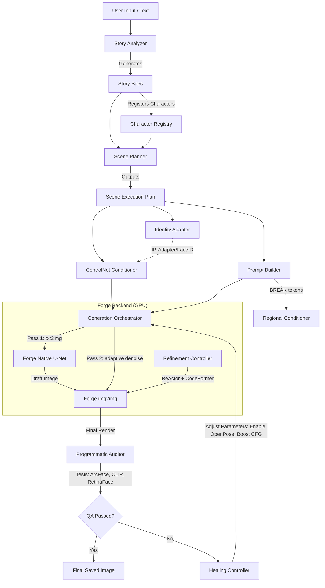

# Current Runtime Architecture
*Visualizing the execution flow of the active Multi-Modal Character Consistency Pipeline (MMCCP).*

## System Architecture Diagram

## Runtime Behavior Summary

1. **Ingestion:** Narrative text is parsed by the `StoryAnalyzer` (using LLMs or heuristics) to construct a `StorySpec` containing defined characters and scenes.
2. **Registration:** `CharacterRegistry` loads and secures canonical character anchors in memory.
3. **Planning:** The `ScenePlanner` reads a `SceneSpec` and determines the camera angle, needed denoising strength (based on shot type), and retrieves correct character anchors. The `PromptBuilder` manages spatial tagging.
4. **Conditioning:** Adapters (`IPAdapterSDXLConditioner`) compile Forge ControlNet payloads.
5. **Generation Pass 1:** The `GenerationOrchestrator` calls Forge's `txt2img` to lay down a structural draft using native modifications (FreeU, PAG, CFG-Fix).
6. **Generation Pass 2:** The orchestrator passes the draft to Forge's `img2img` with the computed adaptive denoising schedule. The `RefinementController` activates ReActor+CodeFormer to sharpen and fix facial consistency.
7. **Quality Audit:** The `ProgrammaticAuditor` intercepts the final image, evaluating face count, identity likeness (ArcFace), and prop existence (CLIP).
8. **Self-Healing:** If the auditor flags a failure, the `HealingController` steps in, dynamically adjusts settings (e.g., turning on OpenPose for spatial overlap failures), and re-triggers generation up to a max retry limit.
